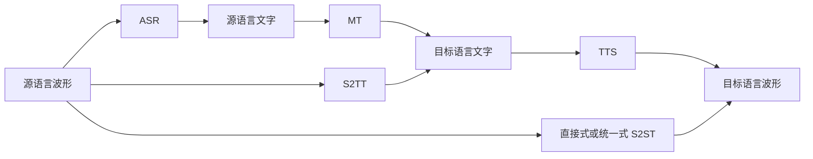

# S2ST 领域总览

## 一个贯穿全库的例子

输入中文录音“明天上午十点见”，输出英文语音“See you at ten tomorrow morning”。源文本、英文译文、英文波形是三种不同对象。语义要正确，声音要可懂、自然；如果研究目标包括原说话人的音色或情感，还必须单独建模和评价。

S2ST = Speech-to-Speech Translation，研究跨语言语音翻译。ASR/STT 输出同语言文字；S2TT/ST 输出另一语言文字；MT 输入输出均为文字；TTS 把给定文字读出来；Voice Conversion 通常改变音色等属性，本身不保证翻译。这些任务不能因都涉及“语音转换”就混用。

图中是三条可选路径，不要求一次经过所有节点。[级联式](../02-技术路线/级联式S2ST.md)易于逐模块诊断；[直接式](../02-技术路线/直接式S2ST.md)研究怎样联合生成；[混合与统一](../02-技术路线/混合式与统一模型.md)关注模块复用和多任务。直接式也可能经过内部文本表示，详见[分类轴](技术路线分类.md)。

## 输入怎样变成模型能处理的对象

波形是按采样率排列的实数。可先转成[时频特征](../01-基础知识/数字音频基础.md)，再由编码器压缩为带上下文的向量序列。解码器依据这些向量生成文字、声学特征或[离散单元](../01-基础知识/语音编码与离散表示.md)。最后可能需要[声码器](../01-基础知识/声码器与波形生成.md)恢复波形。

编码器不必“输出一句完整含义”，而是学习对目标任务有用的表示。损失函数衡量预测与训练目标的差异；推理阶段没有正确答案可供对照，模型只能按自己的生成结果继续运行。[Seq2Seq 文档](../01-基础知识/Transformer与Seq2Seq.md)给出张量和训练/推理示例。

## 研究地图

| 层面 | 核心问题 | 对应材料 |
| --- | --- | --- |
| 内容理解 | 说了什么、应该怎样翻译 | [ASR](../01-基础知识/语音识别-ASR.md)、[MT](../01-基础知识/机器翻译-MT.md) |
| 语音生成 | 用什么表示、怎样生成、何时发声 | [TTS](../01-基础知识/语音合成-TTS.md)、[VITS](../03-模型研究/VITS.md)、[S2UT](../03-模型研究/S2UT.md) |
| 条件控制 | 谁在说、怎样说、能否跨语言保留 | [音色与情感](../05-质量评价/音色与情感保留.md) |
| 数据与训练 | 配对语音不足时怎样学 | [ComSpeech](../03-模型研究/ComSpeech.md)、[数据集索引](../04-论文阅读/数据集与基准索引.md) |
| 运行形态 | 整句还是边听边译、资源如何约束 | [SeamlessStreaming](../03-模型研究/SeamlessStreaming.md)、[实验方案](../07-实验/实验路线与比较协议.md) |
| 研究证据 | 质量、延迟、资源能否公平比较 | [评价总览](../05-质量评价/评价体系总览.md)、[综述框架](../06-综述写作/综述提纲.md) |

从 CNN 进阶时，可以先理解序列长度、Attention、交叉熵和采样，不必先推导所有生成模型。[研究问题](研究问题与挑战.md)和[我的疑问](../08-研究思考/我的疑问.md)用于把陌生概念变成具体问题。

来源：[Sperber & Paulik, ACL 2020](https://aclanthology.org/2020.acl-main.661/)支持语音翻译系统的耦合方式及其权衡；[S2UT 原文](https://aclanthology.org/2022.acl-long.235/)支持离散目标路线；[UnitY 原文](https://aclanthology.org/2023.acl-long.872/)说明两阶段直接式。这里是教学地图，不是严格唯一的分类标准。
