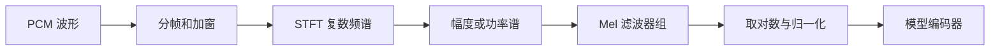

# 数字音频基础：从波形到张量

## 音频文件里有什么

波形 $x[n]$ 是每隔 $1/f_s$ 秒测得的幅值。采样率 $f_s$ 决定单位时间的采样点数；声道数决定每个时刻有几路数值；位深描述 PCM 存储精度。采样率和音量不是一回事。

例如 3 秒、16 kHz、单声道：$N=3\times16000=48000$，模型可能接收 `[batch, samples] = [1, 48000]`。另一库可能返回 `[channels, samples]`，必须读接口，不应仅根据维度猜含义。

把文件头从 48 kHz 改成 16 kHz 会改变播放速度。**重采样**要重新计算采样点，并在降采样前处理超出新 Nyquist 频率的成分。立体声转单声道也应记录方法，简单平均可能因相位抵消而衰减。

## 常见数据流

STFT 用短时间窗观察频率成分。`n_fft` 决定频率格点数，`hop_length` 决定相邻帧跨多少采样点。25 ms 窗在 16 kHz 下是 400 点，10 ms 帧移是 160 点，这只是解释用配置，不是所有模型的标准。

Mel 特征常见 `[B, n_mels, T]`，进入注意力层前可能转成 `[B, T, D]`。帧数取决于 padding、窗口和库；不要用时长推导一个“精确通用”帧数。Mel 通常丢失相位等信息，需要生成式[声码器](声码器与波形生成.md)补足，并非无损可逆。

## 第一次检查录音要回答什么

采样率、声道、位深、时长是否符合输入约定？有没有静音、削波、背景噪声？截短是否切掉了字尾？记录原文件哈希，预处理后另存，保持可追溯。标准库检查脚本见[第一次实践](../07-实验/第一次实践.md)。本次不自动重采样，也不改动用户音频。

参考：[PyTorch Audio 官方特征教程](https://docs.pytorch.org/audio/stable/tutorials/audio_feature_extractions_tutorial.html)。本文是通用教学说明；实际 ASR/TTS 的特征参数必须使用该模型配置。
