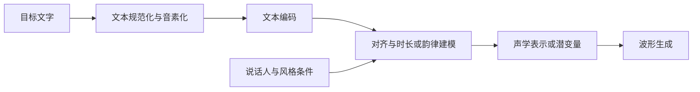

# 语音合成 TTS：本项目的生成主线

## 同一句文字可以有很多种读法

输入文字以及可选的语言、说话人、风格条件，输出波形和采样率。文字只确定部分内容，同一句“真的？”可以惊讶、怀疑或确认，因此 TTS 是一对多生成，不是查表复原唯一声音。

这是一张教学共性图。两阶段 TTS 可以先生成 Mel 再由声码器合成；[VITS](../03-模型研究/VITS.md)联合潜变量建模和波形生成。部分现代模型预测 codec tokens 或连续潜变量，随后解码，不能强行都画成 Mel。

## 生成模型需要解决的三件事

1. **内容编码**：字词、音素怎样变成上下文向量？数字、英文缩写、中英混读如何规范化？
2. **对齐和展开**：文本长度与声学帧数不同；时长预测决定每个符号占多少时间，对齐帮助训练找到对应关系。
3. **采样和波形**：从潜空间、频谱或 codec 表示生成高频细节；使用什么概率模型决定多样性和计算成本。

典型目标包括频谱重建、潜变量 KL、时长损失、对抗损失；这些目标并不在所有模型中同时出现。KL 约束两种潜变量分布，对抗训练让生成波形更接近真实数据分布。扩散通过多步去噪采样，Flow Matching 学习连续路径上的速度场；这里只保留定位，精确方程待以后专页。

## 在 S2ST 中怎样研究它

先使用固定目标文字比较生成器，定位自然度、可懂度、速度；再接翻译系统，看译文错误如何进入音频。[MeloTTS](../03-模型研究/MeloTTS.md)作为可实践入口；其说话人选项不等于任意音色克隆。研究重点应放在表示、对齐、生成和控制，评价用于验证这些选择。

来源：[VITS](https://proceedings.mlr.press/v139/kim21f.html)、[可控 TTS 综述](https://arxiv.org/abs/2412.06602)；连接[离散表示](语音编码与离散表示.md)、[声码器](声码器与波形生成.md)与[生成评价](../05-质量评价/语音自然度与音质.md)。
