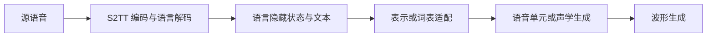

# 混合式与统一模型

## 复用子任务能力

S2ST 配对语音少，但文字翻译、S2TT、TTS 有各自的数据和模型。研究者可以先学子任务，再把中间连续表示和目标生成连起来。这里用“混合式”作为学习导航，并非一个所有论文认可的严格类别。

- [UnitY](../03-模型研究/UnitY.md)：两阶段，先语言表示后离散 units，仍被作者称为直接式。
- [ComSpeech](../03-模型研究/ComSpeech.md)：将 S2TT 与 TTS 通过适配机制组合，另研究不使用平行 S2ST 语音的训练。
- [SeamlessM4T](../03-模型研究/SeamlessM4T.md)：统一语音/文字输入输出任务；v2 和流式系统分别有自己的机制与权重。

“统一多任务”描述任务覆盖，“混合/组合”描述模块来源，“两阶段”描述解码数据流。一个系统可同时有多种属性。不能因为统一模型支持 MT，就认为任意语言均支持语音生成；不能把 v2 当成默认具备 SeamlessExpressive 的表现力。

精读时分别核对初始化、冻结参数、优化阶段、梯度能否传播到上游模块、推理是否用硬 token 或连续状态。对应来源：[ComSpeech](https://aclanthology.org/2024.acl-long.392/)、[Seamless 报告](https://arxiv.org/abs/2312.05187)。
