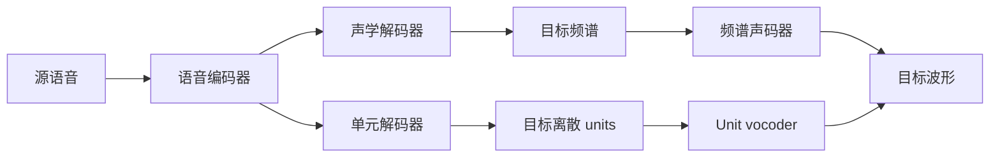

# 直接式 S2ST：预测频谱还是离散单元

直接式通常把跨语言内容转换与语音输出置于可联合优化的模型中；是否产生文本要单独说明。它不天然保证更快、更准或保留情感，性能要看训练数据、解码与生成器。

这是两种候选路径，并非同一模型必有两个头。频谱路线见[Translatotron](../03-模型研究/Translatotron.md)；单元路线见[S2UT](../03-模型研究/S2UT.md)。

训练时，源/目标平行语音提供语义对应，目标频谱可用回归损失，离散序列可用交叉熵；辅助文本监督可稳定对齐或内容学习。推理没有目标语音，模型须自行产生整段目标表示。目标序列长、重复或对齐失败可能影响稳定性，这些是待检验因素，不是这里替每篇论文下结论。

读论文时先查：目标表示如何提取？目标是否去重？训练是否用了文本？声码器是独立预训练还是联合训练？报告的 BLEU 来自哪一个评价 ASR？实际支持哪一语言方向？

两阶段直接模型继续看[混合式与统一模型](混合式与统一模型.md)；术语依据[UnitY 原文](https://aclanthology.org/2023.acl-long.872/)与[S2UT 原文](https://aclanthology.org/2022.acl-long.235/)。
