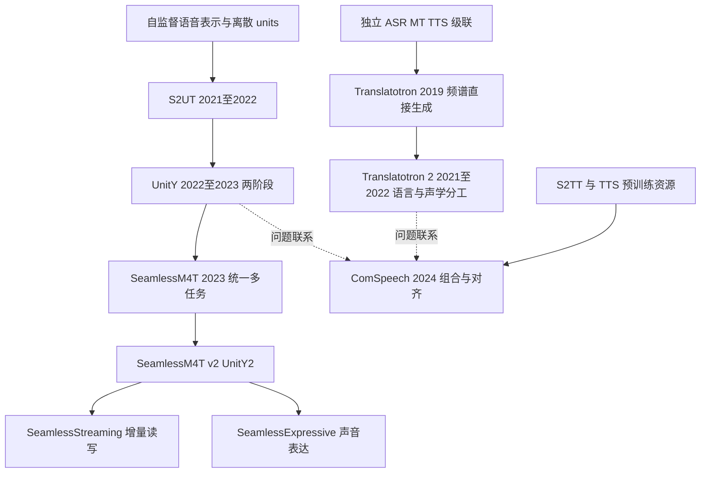

# 文献关系与发展脉络

这张图表达方法继承和问题联系，不宣称所有后续模型严格替代前代。年份按首次报告/正式发表区分，完整题录在[论文索引](论文索引.md)。

- [Translatotron](../03-模型研究/Translatotron.md)到[Translatotron 2](../03-模型研究/Translatotron-2.md)：从验证可行性到更明确的语言/声学生成分工。
- [S2UT](../03-模型研究/S2UT.md)到[UnitY](../03-模型研究/UnitY.md)：目标从离散单位到文本先行的两阶段生成。
- [Seamless](../03-模型研究/SeamlessM4T-v2.md)将多任务、数据规模、生成效率与运行方式继续展开；不同家族成员能力不要混写。
- [ComSpeech](../03-模型研究/ComSpeech.md)强调如何复用已有 S2TT/TTS 与非 S2ST 平行数据，不是一条只靠扩大训练规模的故事。

实线来自原始摘要/报告明确的方法关系，虚线为本库组织问题的联系，不能当作正式引用关系。引用图、作者批评和严格的“改进自”关系需精读 references 后继续修订。

待补：每个箭头的原文定位；代表性相反证据；2024 以后语音生成及音频语言模型分支的系统检索。本图不宣称截至 2026 年的完整领域谱系。
