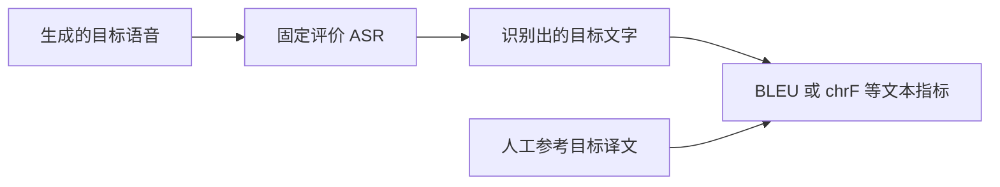

# 语义与翻译质量

## 先确定比较对象

ASR-BLEU 不是直接听语音的模型：分数同时受翻译、发音、音质和评价 ASR 影响。固定评价器及其 checkpoint、语言设置、分词器、文本规范化，保存评价器原始转写。切勿以系统内部生成的译文代替输出音频转写，否则漏掉合成错误。

BLEU 衡量 n-gram 重合；chrF 侧重字符 n-gram；两者都可能惩罚正确的不同表达。COMET 是学习型文本评价框架，不是一个跨版本固定评分公式；使用何种模型、是否需源句/参考、分数尺度都应记录。它不直接判断声学自然度。

对中文输出明确中文分词/字符方案、简繁体、标点、数字读法。WER/CER 更适合看识别或朗读可懂度；输出可以是正确的另一种译法，因此不能把它对单一翻译参考的高编辑距离直接判为翻译差。

## 初次比较最有价值的记录

人工源转写、至少一条目标参考、系统译文、输出 ASR 转写、关键实体/否定/数值错误、是否漏译/增译。小样本自动分数仅用于调试，不用于声称新方法优越。

来源：[COMET, EMNLP 2020](https://aclanthology.org/2020.emnlp-main.213/)、[BLEU 报告规范](https://aclanthology.org/W18-6319/)。语音空间评价如 BLASER 可以作为后续阅读分支，尚未在本库实现或核验适用模型版本。
